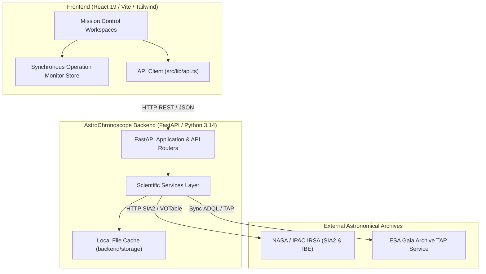

# System Architecture

AstroChronoscope is designed around a synchronous, service-oriented architecture connecting a React single-page frontend to a FastAPI scientific backend and live astronomical archives.

## 1. High-Level Architecture

The frontend communicates exclusively with the AstroChronoscope FastAPI backend over JSON REST endpoints. The backend serves as the sole gateway to external astronomical archive services (NASA/IPAC IRSA and ESA Gaia Archive). The browser never makes direct network requests to external archives.



## 2. Frontend Architecture

The frontend is located at the repository root and built with:
- **Framework**: React 19 with TypeScript.
- **Build System**: Vite with Rollup bundling.
- **Styling**: Tailwind CSS with dark ground-station styling (`#000000`, `#0d0d0d`, borders `#262626`).
- **Icons & UI Components**: Custom loading components (TwinOrbit) and Lucide icon primitives.

### State Organization

1. **Mission Control Orchestrator (`src/components/Dashboard.tsx`)**:
   - Manages celestial target coordinates, radius, band filters, and date ranges.
   - Holds shared data models: discovered timeline products, active selection, comparative products (Epoch A and B), extracted light curve points, spectral profiles, and Gaia cross-match results.
   - Coordinates tab transitions across the six workspaces.
2. **Synchronous Operation Monitor (`src/lib/operationMonitor.ts`)**:
   - Centralized singleton store tracking in-flight and completed API calls.
   - Uses React `useSyncExternalStore` for tear-free reactivity.
   - Enforces deduplication keys to prevent duplicate in-flight requests.
   - Maintains a sliding history window capped at 100 entries.
3. **Benchmark Targets Dataset (`src/data/benchmarkTargets.ts`)**:
   - Centralized typed catalog of the five NASA benchmark targets.
   - Astrometric coordinate validation routines and linear space-motion proper motion propagation.

## 3. Backend Architecture

The backend is located in `backend/app/` and built with FastAPI and Python 3.14.

### Directory Structure

```text
backend/
├── app/
│   ├── api/v1/          # REST route handlers
│   │   ├── health.py        # Service health checks
│   │   ├── telemetry.py     # Local storage telemetry
│   │   ├── observations.py  # Observation cone search and cutout endpoints
│   │   ├── timeline.py      # Multi-epoch target timeline endpoint
│   │   ├── images.py        # FITS inspection and image comparison endpoints
│   │   ├── lightcurves.py   # Aperture photometry and light curve endpoints
│   │   ├── spectra.py       # 1D spectral cube extraction and comparison
│   │   ├── gaia.py          # Gaia DR3 cone search and cross-matching
│   │   └── files.py         # Static file delivery for generated FITS/PNGs
│   ├── core/            # Configuration and custom exception classes
│   ├── schemas/         # Pydantic input and output data models
│   └── services/        # Scientific computation and archive client modules
├── tests/               # Pytest unit, integration, and contract tests
├── storage/             # File cache for downloaded FITS and generated previews
├── docs/                # Backend integration specifications
└── pyproject.toml       # Authoritative dependencies with pinned versions
```

### Scientific Service Layer

- **IRSA Client (`irsa_client.py`)**: Executes SIA2 HTTP queries to IRSA, parses VOTable XML responses, and normalizes product records.
- **FITS Service (`fits_service.py`)**: Downloads, validates, and caches FITS files with size limits and cryptographic SHA-256 verification.
- **WCS Service (`wcs_service.py`)**: Extracts celestial WCS solutions using Astropy and verifies target containment within image boundaries.
- **Preview Service (`preview_service.py`)**: Generates 8-bit PNG previews using percentile clipping and contrast scaling, secured with threading locks for Windows file safety.
- **Reprojection Service (`reprojection_service.py`)**: Uses flux-conserving bilinear interpolation to resample target images onto reference grids.
- **Comparison Service (`comparison_service.py`)**: Computes difference images, evaluates alignment residuals via FFT phase-correlation, and propagates variance arrays.
- **Photometry Service (`photometry_service.py`)**: Detects point sources and performs circular aperture photometry with local sky background subtraction.
- **Light Curve Service (`lightcurve_service.py`)**: Constructs multi-epoch light curves and computes variability metrics including the Stetson J index.
- **Spectral Service (`spectral_service.py`)**: Extracts 1D spectra from SPHEREx DR1 spectral data cubes and performs cross-epoch wavelength correlation.
- **Gaia Client & Service (`gaia_client.py`, `gaia_service.py`)**: Queries the ESA Gaia TAP service using ADQL cone searches, normalizes astrometric records, and caches results.
- **Cross-Match Service (`crossmatch_service.py`)**: Matches SPHEREx detected sources with Gaia catalog entries using spherical distance and Rayleigh positional uncertainty significance.

## 4. External Archive Integrations

### NASA / IPAC IRSA

- **SIA2 (Simple Image Access v2)**: Used for discovery cone queries against the SPHEREx mission archive.
- **IBE (Image Box Extraction)**: Used for retrieving focused spatial cutouts centered on target coordinates.

### ESA Gaia Archive

- **TAP (Table Access Protocol)**: Uses synchronous POST queries against `https://gea.esac.esa.int/tap-server/tap/sync`.
- **Query Language**: ADQL (Astronomical Data Query Language) selecting `source_id`, `ra`, `dec`, `parallax`, `pmra`, `pmdec`, and photometry from `gaiadr3.gaia_source`.
